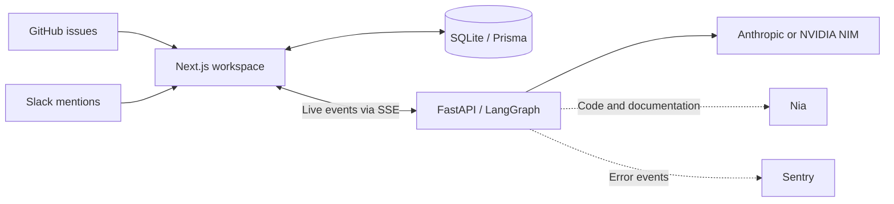

# Buzz

**From bug report to evidence, explanation, and a proposed fix.**

An AI investigation workspace for GitHub issues and Slack reports. Follow each agent as it searches code, reads documentation, and examines logs.

[Quick start](#quick-start) · [How it works](#how-it-works) · [Integrations](#integrations) · [Development](#development)

---

## What Buzz does

A bug report rarely contains everything you need to fix it. Buzz brings the issue, repository, documentation, and error logs into one investigation, with a live view of the evidence each agent collects.

| Step | What you get |
| --- | --- |
| **Capture** | A case created from a GitHub issue webhook or a Slack app mention. |
| **Investigate** | Five agent stages covering triage, code search, documentation, logs, and patch generation. |
| **Follow the evidence** | Live agent events, suspect files, referenced lines, reasoning, and confidence. |
| **Propose a fix** | Generated source and test changes, with an attempt to push a branch and open a pull request when patching is enabled. |
| **Recover** | Clear failure messages and a retry action when a request fails or the event stream is interrupted. |

Buzz is a development prototype. Cases and state transitions are stored in SQLite; investigation reports currently live in page memory and are lost on refresh.

## How it works



The investigation runs sequentially:

| Agent | Responsibility |
| --- | --- |
| **Triage** | Classify severity, identify the likely module, and summarize the issue. |
| **Codebase search** | Generate investigation questions and collect evidence through Nia or local repository search. |
| **Documentation** | Find relevant Markdown documentation and optionally search an indexed Slack source. |
| **Log analysis** | Examine related Sentry errors and patterns when Sentry is configured. |
| **Patch generation** | Use the collected context to generate code and tests, then attempt branch and PR creation. |

The Next.js app owns the UI, case database, and webhook endpoints. The Python service runs the agents and streams events back through `/api/investigate`.

## Quick start

You need Node.js and npm, Python 3.12, Git, and an API key for your chosen LLM provider. GitHub CLI authentication and repository write access are needed for PR creation.

### 1. Clone and configure

```bash
git clone https://github.com/eddieliu-dev/buzz.git
cd buzz
cp frontend/.env.example frontend/.env
cp backend/.env.example backend/.env
```

Add your Anthropic key to `backend/.env`. The example uses Anthropic to match the web API's current default model. NVIDIA NIM is also supported; see the [backend guide](backend/README.md#llm-configuration) for provider and model selection.

`frontend/.env` includes the local SQLite URL. Replace the Slack and GitHub placeholders when you enable those integrations. The dashboard can start without them, but it will be empty until a case is created.

### 2. Start the web app

In your first terminal:

```bash
cd frontend
npm ci
npm run db:push
npm run dev
```

Open [localhost:3000](http://localhost:3000). Prisma generates its client during installation; `db:push` creates the local database and tables.

### 3. Start the agent service

In a second terminal, from the repository root:

```bash
python3 -m venv backend/.venv
source backend/.venv/bin/activate
python -m pip install -r backend/agents/requirements.txt fastapi==0.115.0 uvicorn==0.30.0
cd backend/agents
python -m uvicorn server:app --reload --port 8000
```

FastAPI and Uvicorn are installed explicitly because they are not listed in the agent requirements file. The API runs at [localhost:8000](http://localhost:8000); check [its health endpoint](http://localhost:8000/health) for `{"status":"ok"}`.

### 4. Run an investigation

For the web flow, [connect GitHub or Slack](#integrations), open a case in the dashboard, and choose **Launch Investigation**.

To try the agents without configuring webhooks, use the included refund scenario. In another terminal, from the repository root:

```bash
source backend/.venv/bin/activate
cd backend/agents
python example/run_pipeline.py --scenario refund_wrong_amount
```

This reads the local `business_case/` source; the demo app does not need to be running. It uses your LLM key, prints progress, and saves `example/last_report.json`. CLI patch generation is disabled by default.

> **Patch behavior:** Web investigations currently enable patch generation. The agent can commit changes, push a branch, and open a pull request using your Git credentials. PRs are currently opened as regular PRs, despite some internal names referring to drafts. CLI runs enable patching only with `--enable-patch-agent`.

## Integrations

Only the integrations you configure are used.

| Integration | Enables | Configuration |
| --- | --- | --- |
| **GitHub** | Create cases from `issues.opened` events. | `GITHUB_WEBHOOK_SECRET` in `frontend/.env`; webhook at `/api/webhooks/github`. |
| **Slack** | Create cases from mentions, post issue summaries, and use thread actions. | `SLACK_BOT_TOKEN`, `SLACK_CHANNEL_ID`, and `SLACK_SIGNING_SECRET` in `frontend/.env`. |
| **Nia** | Repository intelligence and optional indexed Slack context. | `NIA_API_KEY` and optional `NIA_SLACK_SOURCE` in `backend/.env`. Code search queries Nia directly; it does not index repositories automatically. |
| **Sentry** | Analyze error events associated with the issue. | `SENTRY_AUTH_TOKEN`, `SENTRY_ORG`, and `SENTRY_PROJECT` in `backend/.env`. |
| **Atlassian** | Fetch selected Confluence pages or Jira tickets and index them into Nia. | Separate [Atlassian sync utility](nia-atlassian/README.md). |

GitHub and Slack need a public URL to reach your local webhook endpoints. GitHub issue ingestion also posts to Slack, so configure Slack posting first. See the [frontend guide](frontend/README.md#connect-github-and-slack) for setup.

## Development

Run the frontend checks from `frontend/`:

```bash
npm test
npm run lint
npm run typecheck
npm run build
```

The regression tests cover investigation failures, stream parsing, retries, cancellation, and the error UI. They run without API keys. The production build downloads fonts from Google Fonts and needs network access on a fresh build.

| Command | Purpose |
| --- | --- |
| `npm run dev` | Start the web app with live reload. |
| `npm run build` / `npm run start` | Build and serve the production web app. |
| `npm run db:push` | Apply the Prisma schema to the local database. |
| `npm run db:studio` | Inspect cases and transitions in Prisma Studio. |

## Repository map

```text
buzz/
├── frontend/          Next.js UI, API routes, Slack/GitHub integration, Prisma
├── backend/agents/    LangGraph pipeline, agent service, CLI runners, tests
├── business_case/     ShopEasy demo with deliberate discount and refund bugs
└── nia-atlassian/     Confluence/Jira → Nia sync utility
```

| Guide | Read it for |
| --- | --- |
| [Frontend](frontend/README.md) | Environment variables, webhook setup, and UI development. |
| [Backend](backend/README.md) | LLM providers, agent API, CLI usage, and demo scenarios. |
| [Atlassian sync](nia-atlassian/README.md) | Importing external documentation into Nia. |

## Current boundaries

- **Local development:** Case and investigation APIs do not currently have application authentication.
- **Report persistence:** Cases and transition history survive restarts; web investigation reports do not survive a page refresh.
- **Cancellation:** Reset and navigation cancel the client stream. Python agent work already running may continue, and a retry starts a new run.
- **Case lifecycle:** The investigation UI does not yet write its completion status or report back to the case record.
